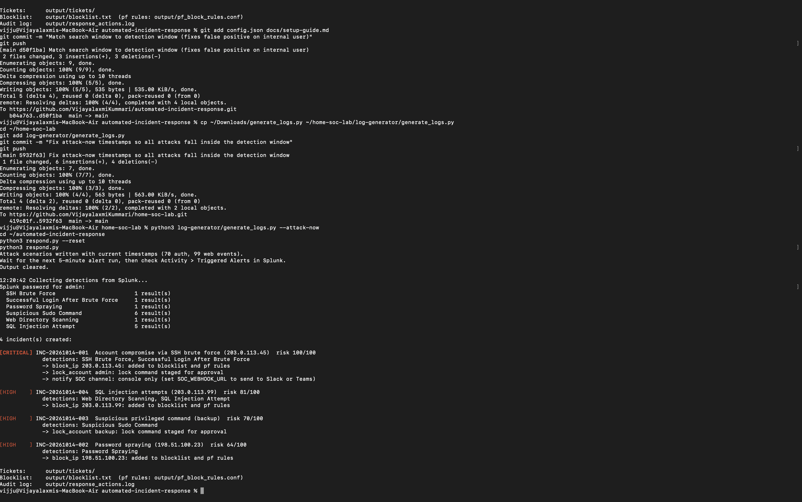

# Automated Incident Response

A small SOAR (Security Orchestration, Automation and Response) engine written in Python. It connects to the Splunk instance from my [Home SOC Lab](https://github.com/VijayalaxmiKummari/home-soc-lab), collects the results of six detection rules, and handles each threat the way a Tier 1 analyst would, in seconds:

1. **Collect** detection results from Splunk through its REST API
2. **Correlate** alerts that share an attacker IP or user account into one incident
3. **Enrich** each IP with threat intelligence and internal-network context
4. **Score** the risk from 0 to 100 and set a severity
5. **Respond** by blocking the IP, staging account locks, opening a ticket and notifying the SOC
6. **Audit** every action to a log that is fed back into Splunk



## Example

One run against the lab produced five incidents from 12 raw alerts:

| Incident | Indicator | Detections combined | Risk | Automated response |
|---|---|---|---|---|
| Account compromise via SSH brute force | 203.0.113.45 | Brute force + successful login | 100 Critical | IP blocked, `admin` lock staged, SOC notified |
| SQL injection attempts | 203.0.113.99 | Directory scan + SQL injection | 81 High | IP blocked |
| Suspicious privileged command | user `backup` | 2 sudo commands | 70 High | Account lock staged |
| Password spraying | 198.51.100.23 | Password spraying | 64 High | IP blocked |
| Web directory scanning | 192.168.1.50 | Directory scan | 30 Low | **Not blocked**: internal address, escalated |

A full ticket generated by the tool: [docs/sample-incident-INC-001.md](docs/sample-incident-INC-001.md)

## How it works

```
Splunk (Home SOC Lab)                       Automated Incident Response
┌────────────────────────┐   REST API    ┌───────────────────────────────────────────┐
│ 6 saved detections      │ ───────────▶ │ collect → correlate → enrich → score       │
│ index=soc_lab           │   :8089      │                     │                       │
│                         │              │      playbook decides the actions          │
│ sourcetype=air:actions  │ ◀─────────── │ block IP · lock account · ticket · notify   │
└────────────────────────┘  audit log    └───────────────────────────────────────────┘
```

The detections are not copied into this project. The tool reads each saved search from Splunk at runtime, so a rule is only ever defined in one place.

### Risk scoring

```
risk = highest detection base score
     + threat-intel reputation × 0.2
     + 5 for each extra detection on the same indicator
```

| Detection | Base score | MITRE ATT&CK |
|---|---|---|
| Successful login after brute force | 90 | T1110, T1078 |
| Suspicious sudo command | 70 | T1548.003 |
| SQL injection attempt | 60 | T1190 |
| SSH brute force | 50 | T1110.001 |
| Password spraying | 50 | T1110.003 |
| Web directory scanning | 30 | T1595.003 |

85+ is Critical, 60+ High, 40+ Medium. IPs are blocked automatically at 60 or above. The playbook for each detection is described in [docs/playbooks.md](docs/playbooks.md).

### Safety rules

Automated containment can do real damage if it gets it wrong, so the engine is deliberately cautious:

- **Internal and allowlisted addresses are never blocked**, only escalated. A vulnerability scanner or a user mistyping a password should not cut off the business.
- **Low-risk activity is not blocked.** A one-off scan from an unknown IP is ticketed, not firewalled.
- **Containment is staged for approval, not executed.** The tool writes firewall rules (`pf_block_rules.conf`) and account lock commands (`accounts_to_lock.sh`) for an analyst to review and apply.
- **Runs are idempotent.** Polling every minute does not re-block an IP or open duplicate tickets.
- **Enrichment never blocks the response.** If a threat-intel lookup fails, the playbook still runs.

## Quick start

No Splunk needed for the demo, and no packages to install (standard library only, Python 3.9+):

```bash
git clone https://github.com/VijayalaxmiKummari/automated-incident-response.git
cd automated-incident-response
python3 respond.py --demo
```

Against the live Home SOC Lab:

```bash
python3 respond.py              # one pass
python3 respond.py --watch 60   # poll Splunk every minute
python3 respond.py --reset      # clear tickets, blocklist and state
```

The full setup, including sending the audit log back into Splunk, is in [docs/setup-guide.md](docs/setup-guide.md).

### Optional integrations

| Environment variable | What it adds |
|---|---|
| `SPLUNK_PASSWORD` | Avoids the password prompt (never stored in a file) |
| `ABUSEIPDB_API_KEY` | Live reputation lookups from AbuseIPDB, in addition to the local feed |
| `SOC_WEBHOOK_URL` | Sends critical incidents to a Slack or Teams channel |

## Project layout

```
automated-incident-response/
├── respond.py               # entry point
├── config.json              # Splunk connection, internal networks, allowlist, block threshold
├── air/
│   ├── splunk_client.py     # Splunk REST API client
│   ├── enrichment.py        # threat intel, internal/allowlist checks, optional AbuseIPDB
│   ├── playbooks.py         # per-detection playbooks, correlation and risk scoring
│   ├── actions.py           # block, lock, ticket, notify, audit
│   └── responder.py         # orchestration and CLI
├── data/                    # local threat-intel feed and sample alerts for demo mode
├── splunk/                  # config to ingest the audit log into Splunk
├── tests/                   # 10 unit tests, including a fake Splunk server
└── docs/
```

## Tests

```bash
python3 -m unittest discover tests -v
```

These cover correlation, scoring, the "never block internal or allowlisted" rule, idempotent blocking, multivalue Splunk fields, and the Splunk client against a fake REST server.

## What I learned

- Correlation matters more than the individual alert. Merging the brute force and the successful login from the same IP produced one Critical incident instead of two separate High tickets, which is what an analyst actually needs to see first.
- Writing the safety rules took longer than the blocking logic. Deciding when *not* to act is the hard part of automation.
- Logging every automated action back into the SIEM keeps the automation accountable: anyone can search exactly what it did and why.

## Tools

Python 3 (standard library), Splunk Enterprise REST API, SPL, MITRE ATT&CK, pf firewall rules, macOS

All attacker IPs come from the reserved documentation ranges (RFC 5737), so none of them belong to real systems.
